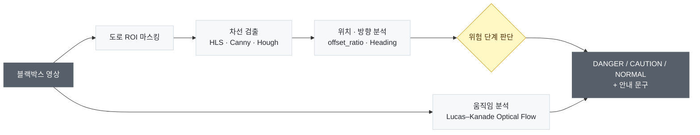

# 블랙박스 주행상황 분석
**Driving Analysis**

블랙박스 영상만으로 차선 이탈 위험을 판단하고 운전자에게 실시간 주행 상태를 안내하는 시스템

`ACE Lab 하계 코딩캠프 해커톤` · `2026.08` · `2인 팀`

## 개요

경북대학교 전자공학부 ACE Lab 하계 코딩캠프의 자율주행 프로그래밍 과정에서 진행한 해커톤 프로젝트입니다. 시스템은 두 파트로 나뉩니다.

- ① 전방 객체 탐지
- ② **[차량 주행 분석](vehicle-driving-analysis/)** ← 내 담당 (구현 · 발표)

## 처리 흐름

## 내 담당 — 차량 주행 분석

> 코드 · 노트북 · 상세 설명은 **[`vehicle-driving-analysis/`](vehicle-driving-analysis/)** 에 있습니다.

### 1. 차선 검출

- 도로 영역만 남기도록 사다리꼴 **ROI**를 마스킹
- **HLS** 흰색·노란색 마스크와 **Canny** 에지의 교집합에서 **HoughLinesP**로 좌·우 차선 검출

### 2. 차량 위치 · 방향 분석

- 차선 중심과 차량(화면) 중심의 차이를 **차선 폭으로 나눈 비율**(`offset_ratio`)로 편향 계산
- 좌·우 차선 중앙선의 기울기로 진행 방향각 **Heading** 계산, 결과를 영상 위에 시각화

### 3. 움직임 분석

- **Lucas–Kanade Optical Flow**로 도로 하단 특징점 이동거리의 중앙값을 계산해 상대 움직임 추정

### 4. 위험도 판단

<table>
<thead><tr><th>단계</th><th>조건</th></tr></thead>
<tbody><tr><td>🔴 <b>DANGER</b></td><td><code>|offset_ratio| ≥ 0.25</code> 또는 차선 이탈</td></tr></tbody>
<tbody><tr><td>🟡 <b>CAUTION</b></td><td>차선 인식 불안정 · <code>|offset_ratio| ≥ 0.10</code> · 차선 근접 · <code>|heading| ≥ 12°</code></td></tr></tbody>
<tbody><tr><td>⚪ <b>NORMAL</b></td><td>그 외</td></tr></tbody>
</table>

단계별로 운전자에게 보여줄 안내 문구를 출력합니다.

## 결과

- 수업의 차선 인지 알고리즘을 실제 블랙박스 주행 영상의 모든 프레임에 적용
- Heading과 편향 비율을 결합해 직선 · 곡선 구간의 주행 상태를 구분

## 한계 및 개선 방향

**한계**
- 차선이 흐리거나 가려지면 검출 성능 저하
- 임계값을 경험적으로 정해 상황에 따라 판단 결과가 달라질 수 있음
- 실제 차속이 아닌 영상상 상대 움직임만 분석 가능

**개선 방향**
- ① 객체 탐지 결과(차간 거리·속도)와 결합한 종합 위험도 판단
- 운전 습관 분석, 사고 예방 시스템으로 확장

## 기술 스택

`Python` `OpenCV` `HLS · Canny · HoughLinesP` `Lucas–Kanade Optical Flow` `NumPy` `pandas`

## 팀 구성

<table>
<thead><tr><th>이름</th><th>역할</th></tr></thead>
<tbody><tr><td><b>안유빈</b></td><td><b><a href="vehicle-driving-analysis/">② 차량 주행 분석</a> (구현 · 발표)</b></td></tr></tbody>
<tbody><tr><td>조윤서</td><td>① 전방 객체 탐지</td></tr></tbody>
</table>
