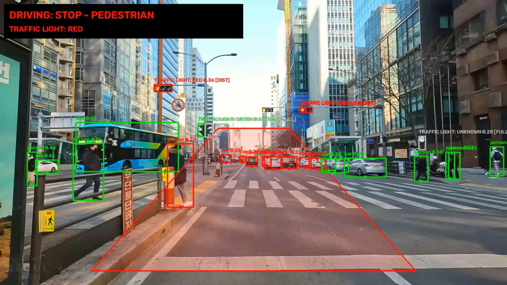
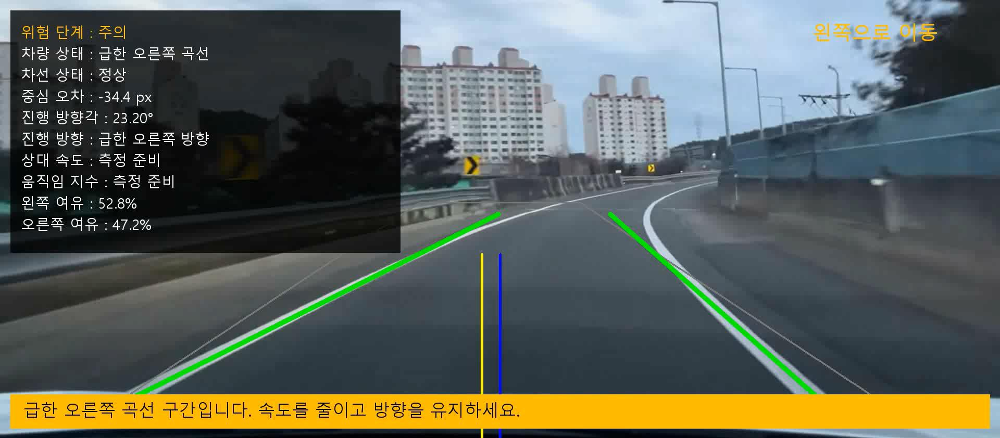

# 차량 주행상황 분석
**Driving Analysis**

블랙박스 영상에서 전방 객체 · 신호등 · 차선을 인식하고, 운전자에게 실시간 주행 상태와 위험을 안내하는 시스템

`ACE Lab 하계 코딩캠프 해커톤` · `2026.08` · `2인 팀` · [`발표 자료 (PDF)`](docs/presentation/driving-analysis-presentation.pdf)

<p>


</p>
<sub>왼쪽: ① 전방 객체 탐지 — 위험 영역 내 보행자 감지 시 정지 판단 / 오른쪽: ② 차량 주행 분석 — 급곡선 구간 주의 안내</sub>

## 개요

경북대학교 전자공학부 ACE Lab 하계 코딩캠프의 자율주행 프로그래밍 과정에서 진행한 해커톤 프로젝트입니다.
하나의 블랙박스 영상을 두 관점에서 분석하도록 시스템을 두 파트로 나눴습니다.

## 시스템 구성

| | ① 전방 객체 탐지 — 조윤서 | ② [차량 주행 분석](vehicle-driving-analysis/) — **안유빈 (내 담당 · 구현 · 발표)** |
|---|---|---|
| **질문** | 앞에 "무엇이" 있는가 | 내 차가 차선 안에서 "어떻게" 달리고 있는가 |
| **인식** | YOLO 객체 탐지 (차량 · 사람 · 신호등) | HLS · Canny · Hough 차선 검출 |
| **분석** | 신호등 색상 판별, 위험 영역 내 객체 확인 | 위치(`offset_ratio`) · 방향(Heading) · 상대 움직임(Optical Flow) |
| **판단** | `STOP` · `PEDESTRIAN WARNING` | `DANGER` · `CAUTION` · `NORMAL` |
| **출력** | 바운딩 박스 · 신호등 상태 · 위험 영역 통합 표시 | 상태 오버레이 + 운전자 안내 문구 |

> ② 차량 주행 분석의 처리 흐름 · 판단 규칙 · 코드 · 개발 과정은 **[`vehicle-driving-analysis/`](vehicle-driving-analysis/)** 에서 볼 수 있습니다.

## 한계와 개선 방향

**한계**

- 영상 기반 테스트만 수행했으며 실제 차량 제어와는 연동하지 않음
- 위험 영역 좌표 · 판단 임계값이 고정 · 경험적 값이라 환경에 따라 결과가 달라짐
- 차선이 흐리거나 가려지면 검출 성능 저하, 실제 차속이 아닌 영상상 상대 움직임만 분석 가능

**개선 방향**

- ①과 ②를 결합한 **종합 주행 위험도 판단** (객체 거리 · 속도 + 차선 위치)
- 거리 추정 기능 추가, 거리와 위치에 따른 위험도 세분화
- 야간 · 악천후 등 다양한 환경에서 성능 검증
- 블랙박스 기반 운전 습관 분석 및 사고 예방 시스템으로 확장

## 기술 스택

`Python` `OpenCV` `YOLO` `HLS · Canny · HoughLinesP` `Lucas–Kanade Optical Flow` `NumPy` `pandas`

## 저장소 구조

```
driving-analysis/
├── vehicle-driving-analysis/   ② 차량 주행 분석 — 상세 README · 노트북 · 코드
└── docs/
    ├── images/                 대표 결과 이미지
    └── presentation/           발표 자료 PDF
```
