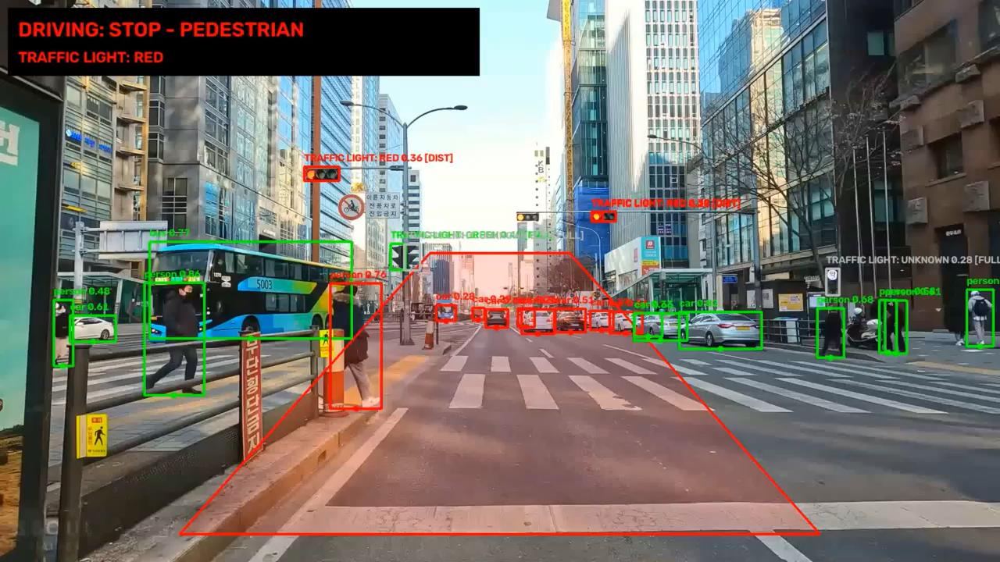
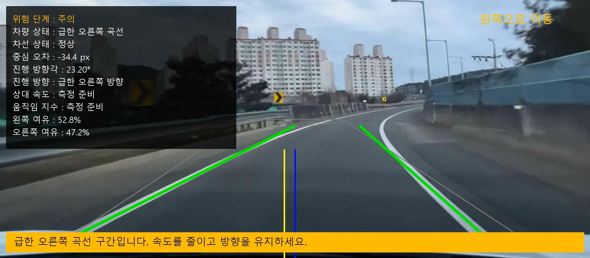
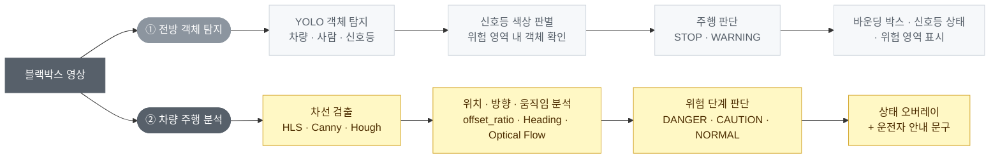

# 차량 주행상황 분석
**Driving Analysis**

블랙박스 영상만으로 전방 객체 · 신호등 · 차선을 인식하고, 운전자에게 실시간 주행 상태와 위험을 안내하는 시스템

`ACE Lab 하계 코딩캠프 해커톤` · `2026.08` · `2인 팀` · [`발표 자료 (PDF)`](docs/presentation/driving-analysis-presentation.pdf)

왼쪽: ① 전방 객체 탐지 — 위험 영역 내 보행자 감지 시 정지 판단 / 오른쪽: ② 차량 주행 분석 — 급곡선 구간 주의 안내

## 개요

경북대학교 전자공학부 ACE Lab 하계 코딩캠프의 자율주행 프로그래밍 과정에서 진행한 해커톤 프로젝트입니다.
하나의 블랙박스 영상을 두 관점에서 분석하도록 시스템을 두 파트로 나눴습니다.

- ① **전방 객체 탐지** — 앞에 "무엇이" 있는가 (차량·사람·신호등)
- ② **[차량 주행 분석](vehicle-driving-analysis/)** — 내 차가 차선 안에서 "어떻게" 달리고 있는가 ← 내 담당 (구현·발표)

## 시스템 구성

## ① 전방 객체 탐지

**목표** — 주행 전방의 객체를 탐지하고, 신호등을 인식해 주행 상황에 반영

- **YOLO 객체 탐지** — 차량 · 사람 · 기타 주행 객체 검출
- **신호등 탐지 · 분석** — 빨간불 / 초록불 판별, 탐지 영역 개선
- **주행 판단** — 전방 사다리꼴 위험 영역 안의 보행자 · 신호 상태로 `STOP` · `PEDESTRIAN WARNING` 판단
- **최종 영상 통합** — 객체 탐지 결과 · 신호등 상태 · 위험 영역을 한 화면에 표시

## ② 차량 주행 분석 — 내 담당

**목표** — 블랙박스 영상만으로 차선 이탈 위험을 판단하고 운전자에게 주행 상태 피드백 제공

- **차선 및 차량 위치 분석** — 좌·우 차선 검출, 차선 중심과 차량 중심 비교로 편향 · 이탈 방향 판단
- **차량 움직임 분석** — Heading으로 진행 방향 분석, Lucas–Kanade Optical Flow로 상대 움직임 측정
- **주행 위험도 판단** — 주행 상태 · 위험 단계(`DANGER` / `CAUTION` / `NORMAL`) 분류, 상황별 운전자 안내

> 처리 흐름 · 판단 규칙 · 코드 · 개발 과정은 **[`vehicle-driving-analysis/`](vehicle-driving-analysis/)** 에서 볼 수 있습니다.

## 관찰 및 개선 방향

**한계**
- 영상 기반 테스트만 수행했으며 실제 차량 제어와는 연동하지 않음
- 위험 영역 좌표 · 판단 임계값이 고정 · 경험적 값이라 환경에 따라 결과가 달라짐
- 차선이 흐리거나 가려지면 검출 성능 저하, 실제 차속이 아닌 영상상 상대 움직임만 분석 가능

**개선 방향**
- ①과 ②를 결합한 **종합 주행 위험도 판단** (객체 거리 · 속도 + 차선 위치)
- 거리 추정 기능 추가, 거리와 위치에 따른 위험도 세분화
- 야간 · 악천후 등 다양한 환경에서 성능 검증
- 블랙박스 기반 운전 습관 분석 및 사고 예방 시스템으로 확장

## 저장소 구조

<table>
<tbody>
<tr>
<td width="50%" valign="top" align="left">

📁 <a href="vehicle-driving-analysis/"><b>vehicle-driving-analysis</b></a> 
② 차량 주행 분석 — 상세 README · 노트북 · 코드 · 결과

</td>
<td width="50%" valign="top" align="left">

📁 <a href="docs/"><b>docs</b></a> 
발표 자료 PDF · 대표 결과 이미지

</td>
</tr>
</tbody>
</table>

## 기술 스택

`Python` `OpenCV` `YOLO` `HLS · Canny · HoughLinesP` `Lucas–Kanade Optical Flow` `NumPy` `pandas`

## 팀 구성

<table>
<thead><tr><th>이름</th><th>역할</th></tr></thead>
<tbody><tr><td><b>안유빈</b></td><td><b><a href="vehicle-driving-analysis/">② 차량 주행 분석</a> (구현 · 발표)</b></td></tr></tbody>
<tbody><tr><td>조윤서</td><td>① 전방 객체 탐지</td></tr></tbody>
</table>
