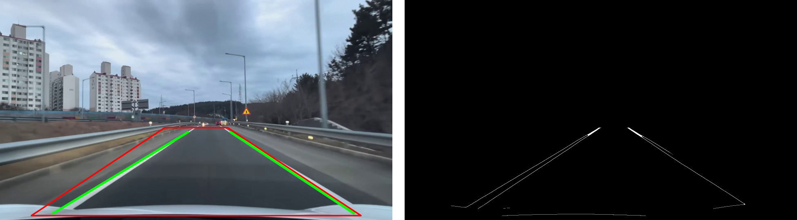
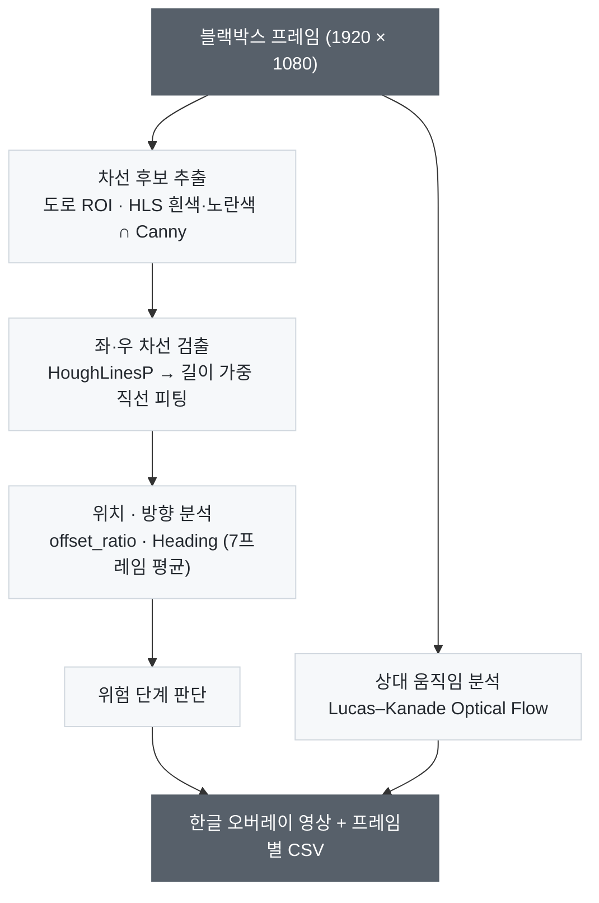
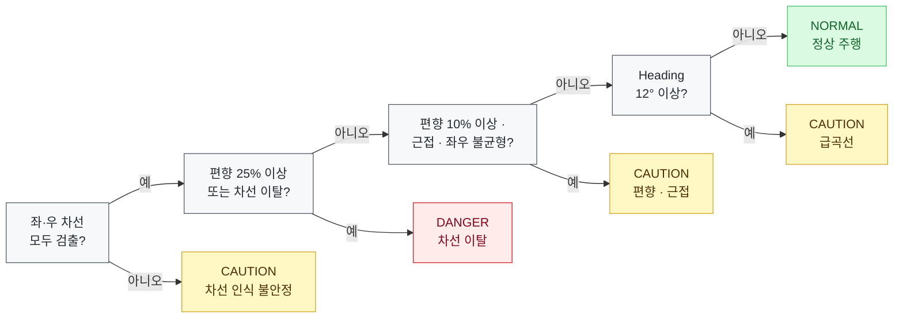
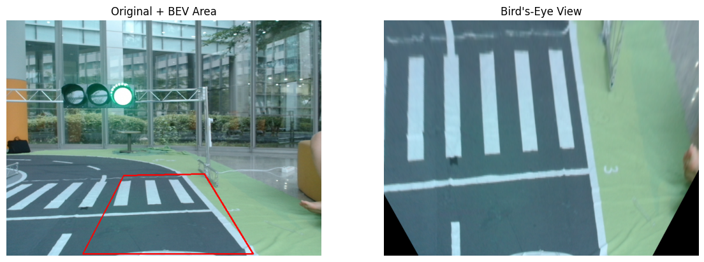
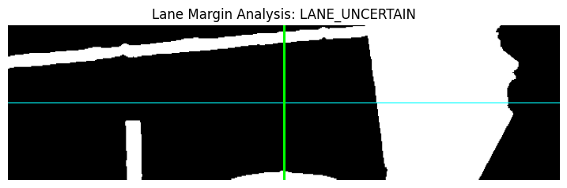

[← 프로젝트 메인](../README.md)

# ② 차량 주행 분석
**Vehicle Driving Analysis** · 블랙박스 주행상황 분석 해커톤 중 담당 파트

> 블랙박스 영상에서 차선 내 차량 위치와 진행 방향을 분석해, 위험 단계와 운전자 안내 문구를 실시간으로 표시하는 시스템



<sub>왼쪽: 도로 ROI(빨강)와 검출된 좌·우 차선(초록) / 오른쪽: HLS 색상 + Canny로 만든 차선 후보 에지</sub>

&nbsp;

<a id="목차"></a>**목차** · [개요](#1-개요) · [데모](#2-데모) · [동작 원리](#3-동작-원리) · [트러블슈팅](#4-트러블슈팅) · [한계 및 개선 방향](#5-한계-및-개선-방향) · [실행 방법](#6-실행-방법) · [폴더 구조](#7-폴더-구조)

&nbsp;

## 1. 개요

ACE Lab 하계 코딩캠프 해커톤에서 ② 차량 주행 분석 파트를 맡아 설계·구현·발표했습니다.

새 모델을 학습하지 않고, 수업 실습의 차선 검출 흐름을 실제 블랙박스 영상으로 옮겨 규칙 기반 주행 상태 판단까지 확장했습니다.

| | 수업 실습 | 이 프로젝트 |
|---|---|---|
| **입력** | 축소 트랙 카메라 사진 1장 | 실제 블랙박스 주행 영상의 모든 프레임 |
| **차선 검출** | BEV 변환 → 기울기 · 중심 좌표 | 원본 시점에서 ROI + HLS · Canny + Hough |
| **출력** | 경로 기울기 → 조향 결정 | 위치 · 방향 · 움직임 분석 → 위험 단계 + 안내 |

<sub>[↑ 목차](#목차)</sub>

&nbsp;

## 2. 데모

### 고속도로 주행

https://github.com/user-attachments/assets/e52af55f-3f94-4801-881d-08453bc208b0

<sub>급한 오른쪽 곡선 진입 시 CAUTION 전환 · 감속 안내</sub>

&nbsp;

### 도심 주행

https://github.com/user-attachments/assets/dc60bd59-534e-4bb5-b99b-9826f01e979c

<sub>앞차 · 노면 표시가 많아 차선 인식이 흔들리는 환경</sub>

&nbsp;

### 결과 요약

| 영상 | 결과 |
|---|---|
| 고속도로 주행 <sub>(test4 · 470 프레임)</sub> | 곡선 구간에서 Heading 20° 이상으로 증가 → **CAUTION** 전환 |
| 도심 주행 <sub>(test3 · 622 프레임)</sub> | 버스 · 승용차 · 차선 변경으로 차선 폭과 중심이 흔들려 NORMAL ↔ CAUTION 전환이 잦음 |

<details>
<summary><b>분석 실패 프레임과 수정</b></summary>
<br>

- 실패 비율 — 고속도로 주행(test4) 12.6% (59 / 470 프레임)
- 원인 — 한쪽 차선만 검출된 프레임에서 결과 변수가 정의되지 않는 `UnboundLocalError: left_x` (곡선 구간에 집중)
- 수정 — [`src/driveguard.py`](src/driveguard.py)에서 변수를 미리 초기화해 '차선 인식 불안정'으로 처리

</details>

<sub>[↑ 목차](#목차)</sub>

&nbsp;

## 3. 동작 원리

### 처리 흐름



<details>
<summary><b>단계별 세부 기준</b></summary>
<br>

| 단계 | 기준 |
|---|---|
| 차선 후보 | 흰색·노란색 색상 마스크와 Canny 에지가 겹치는 부분만 사용 (건물 · 그림자 에지 제거) |
| 차선 검출 | 기울기 0.35 ~ 5.0 선분만 사용, 차선 폭이 영상 폭의 18 ~ 75%를 벗어나면 오검출로 폐기 |
| 위치 분석 | 편향을 차선 폭 기준 비율로 계산해 해상도와 무관하게 판단 |
| 움직임 분석 | 도로 하단 특징점 이동거리의 중앙값 사용 (60px 이상은 이상치로 제외) |

</details>

&nbsp;

### 판단 규칙



차선을 못 찾은 경우는 실제 위험이 아니라 판단 불가이므로 DANGER가 아닌 CAUTION으로 분류했습니다.

<details>
<summary><b>용어 · 기준값 설명</b></summary>
<br>

| 항목 | 정의 · 기준 |
|---|---|
| 편향 (`offset_ratio`) | (차선 중심 − 차량 중심) ÷ 차선 폭, 0이면 정중앙 |
| 차선 근접 (`margin_ratio`) | 좌·우 차선까지 여유 중 작은 쪽 ÷ 차선 폭이 0.25 미만 |
| 좌우 불균형 | 좌·우 여유 비율 차이가 0.10 초과 |
| 진행 방향 (Heading) | 3° 미만 직진 · 3 ~ 12° 좌/우 진행 · 12° 이상 급한 좌/우 방향 |
| 상대 움직임 | 0.7 미만 정지 · 2.0 미만 저속 · 4.5 미만 보통 · 이상 고속 (px/frame) — 실제 km/h가 아닌 영상 내 픽셀 이동량 |

</details>

<sub>[↑ 목차](#목차)</sub>

&nbsp;

## 4. 트러블슈팅

| # | 문제 | 해결 |
|:-:|---|---|
| 1 | 정상 주행인데 항상 '위험' (중심 오차 −959px) | 수업 함수 대신 좌·우 차선의 중간을 차선 중심으로 사용 |
| 2 | 차선이 거의 검출되지 않음 | 블랙박스 시점과 안 맞는 고정 BEV를 빼고 원본 시점에서 검출 |
| 3 | 편향 기준이 해상도에 따라 흔들림 | 영상 폭 대신 차선 폭으로 정규화 |
| 4 | 차선 미검출 시 실행 중단 | `None` 안전 처리 + 프레임 단위 예외 처리 |
| 5 | 상태 표시가 프레임마다 깜빡임 | 중심 오차 · Heading · 움직임 지수 7프레임 이동평균 |
| 6 | 영상 위 한글 깨짐 | `cv2.putText` 대신 Pillow로 한글 렌더링 |

<details>
<summary><b>원인 자세히 보기</b></summary>
<br>

| # | 원인 |
|:-:|---|
| 1 | 수업용 `get_lane_center()`가 1920px 블랙박스 영상에서 차선 중심을 x≈1로 잘못 반환 |
| 2 | 축소 트랙 카메라 기준의 고정 BEV 좌표가 블랙박스 시점과 맞지 않음 |
| 3 | 중심 오차를 영상 폭으로 정규화 |
| 4 | `None` 값에 포맷 · `abs()` 적용, 빈 배열 평균 (`TypeError`, `Mean of empty slice`) |
| 5 | 프레임 단위 값을 그대로 사용 |
| 6 | `cv2.putText`는 한글 미지원 |

버전별 변경 내용은 [`archive/README.md`](archive/README.md) 참고

</details>

<sub>[↑ 목차](#목차)</sub>

&nbsp;

## 5. 한계 및 개선 방향

**한계**

- 차선이 흐리거나 가려지면 검출 성능 저하 (곡선 · 도심 구간에서 한쪽 차선 누락)
- 임계값이 경험적 값이라 영상 환경에 따라 판단이 달라짐
- 실제 차속이 아닌 영상 속 상대 움직임만 분석 가능
- 블랙박스가 차량 중앙에 설치되었다고 가정

**개선 방향**

- ① 전방 객체 탐지(YOLO)와 결합해 차간 거리 · TTC를 반영한 종합 위험도 판단
- 운전 습관 분석 · 사고 예방 시스템

<sub>[↑ 목차](#목차)</sub>

&nbsp;

## 6. 실행 방법

```bash
pip install -r requirements.txt
python src/driveguard.py data/test4.mp4 --out-dir results
# → results/test4_analyzed.mp4, results/test4_frame_results.csv
```

- 입력 영상은 용량 문제로 포함하지 않았습니다 → [`data/README.md`](data/README.md)
- 패키지 목록 → [`requirements.txt`](requirements.txt)
- 한글 출력에는 맑은 고딕(Windows) 또는 나눔고딕 / Noto Sans CJK(Linux)가 필요합니다.

<details>
<summary><b>노트북 구성</b> — <code>lane_state_analysis_final.ipynb</code></summary>
<br>

[`notebooks/lane_state_analysis_final.ipynb`](notebooks/lane_state_analysis_final.ipynb)

| 절 | 내용 |
|---|---|
| 1 ~ 4 | 환경 설정 — 프로젝트 경로, 수업 라이브러리 등록 · import |
| 5 ~ 10 | 수업 파이프라인 재현 — 샘플 이미지 → BEV → ROI → 이진 마스크 → 대표 기울기 → 차선 중심 |
| 11 ~ 18 | 판단 로직 설계 — 중심 오차, 이탈 상태, 진행 방향, 좌우 여유 폭, 위험 단계, 결과 오버레이 |
| 19 ~ 23 | 블랙박스 영상 분석 — 원본 시점 차선 검출, Optical Flow, 한글 오버레이, 전체 영상 처리 · CSV 저장 |

1 ~ 10절은 ACE Lab 하계 코딩캠프에서 제공한 실습 코드(`ros3_ws`)가 필요하며, 수업 자료라 저장소에는 포함하지 않았습니다.

| 필요한 파일 | 노트북에서 사용한 함수 |
|---|---|
| `camera_perception_func_lib.py` | `bird_convert`, `roi_rectangle_below`, `dominant_gradient`, `get_lane_center` |
| `decision_making_function_lib.py` | `calculate_slope_between_points` |

<p>


</p>
<sub>왼쪽: 수업 파이프라인 재현 — 축소 트랙 영상의 BEV 변환 / 오른쪽: 판단 로직 — 좌·우 차선 위치와 여유 폭 분석</sub>

</details>

<sub>[↑ 목차](#목차)</sub>

&nbsp;

## 7. 폴더 구조

<pre>
lane-analysis/
├── <a href="README.md">README.md</a>
├── <a href="requirements.txt">requirements.txt</a>                      패키지 목록
├── <a href="notebooks/">notebooks/</a>
│   └── <a href="notebooks/lane_state_analysis_final.ipynb">lane_state_analysis_final.ipynb</a>   최종 노트북
├── <a href="src/">src/</a>
│   └── <a href="src/driveguard.py">driveguard.py</a>                     영상 분석 스크립트
├── <a href="archive/">archive/</a>                              개발 노트북 v1 ~ v5
├── <a href="data/">data/</a>                                 입력 영상 안내
└── <a href="docs/images/">docs/images/</a>                          README 이미지
</pre>

영상과 실행 결과(`results/`)는 저장소에 포함하지 않았습니다.

<sub>[↑ 목차](#목차)</sub>
