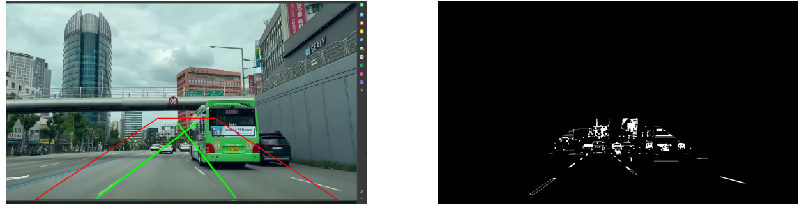
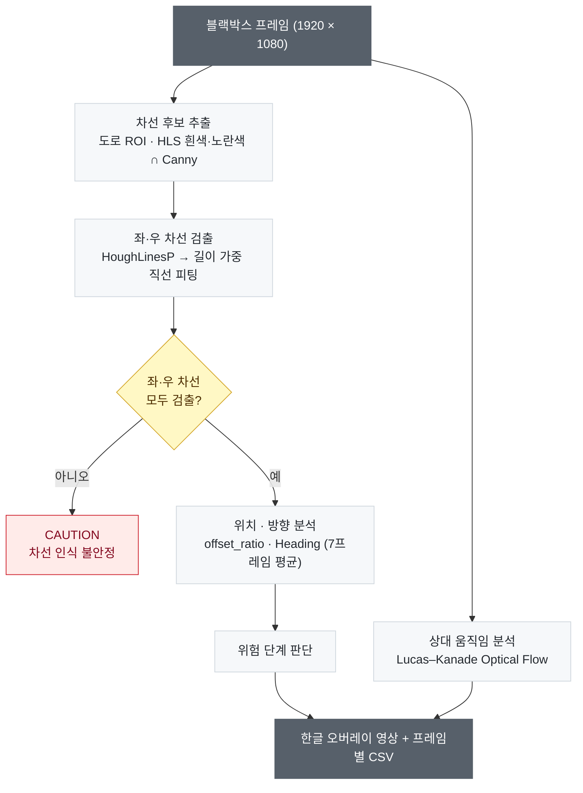
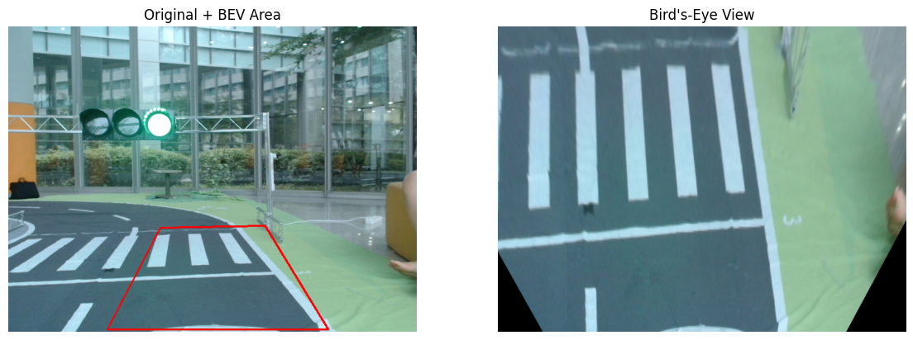
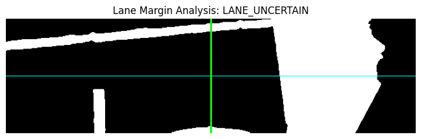

[← 프로젝트 메인](../README.md)

# ② 차량 주행 분석
**Vehicle Driving Analysis** · 블랙박스 주행상황 분석 해커톤 중 내 담당 파트

블랙박스 영상만으로 차선 내 차량 위치 · 진행 방향 · 상대 움직임을 분석하고,
위험 단계와 운전자 안내 문구를 실시간으로 표시하는 시스템



<sub>왼쪽: 도로 ROI(빨강)와 검출된 좌·우 차선(초록) / 오른쪽: HLS 색상 + Canny로 만든 차선 후보 에지</sub>

---

## 개요

경북대학교 전자공학부 ACE Lab 하계 코딩캠프의 자율주행 과정 3주차 해커톤 프로젝트입니다.
주행상황 분석 주제를 ① 전방 객체 탐지, ② **차량 주행 분석**으로 나눠 진행했고, ②를 맡아 설계 · 구현 · 발표했습니다.

수업 실습의 차선 검출 흐름을 실제 블랙박스 영상으로 옮기고, 결과를 주행 상태 판단까지 확장했습니다.

| | 수업 실습 | 이 프로젝트 |
|---|---|---|
| **입력** | 축소 트랙 카메라 사진 1장 | 실제 블랙박스 주행 영상의 **모든 프레임** |
| **차선 검출** | BEV 변환 → 기울기 · 중심 좌표 | 원본 시점에서 ROI + HLS · Canny + Hough |
| **출력** | 경로 기울기 → 조향 결정 (좌 · 직진 · 우) | 위치 · 방향 · 움직임 분석 → **위험 단계 + 운전자 안내** |

> 새 모델을 학습하지 않았습니다. 영상 처리 기반 검출 + 규칙 기반 판단입니다.

---

## 처리 흐름



| 단계 | 세부 기준 |
|---|---|
| 차선 후보 | 흰색·노란색 색상 마스크와 Canny 에지가 **겹치는 부분만** 사용해 건물 · 그림자 에지 제거 |
| 차선 검출 | 기울기 0.35 ~ 5.0 선분만 사용, 차선 폭이 영상 폭의 18 ~ 75%를 벗어나면 오검출로 폐기 |
| 위치 분석 | 편향을 **차선 폭 기준 비율**로 계산해 해상도와 무관하게 판단 |
| 움직임 분석 | 도로 하단 특징점 이동거리의 **중앙값** 사용 (60px 이상은 이상치로 제외) |

---

## 판단 규칙

위에서부터 순서대로 확인해 처음 해당하는 단계로 판단합니다.

| 순서 | 조건 | 판단 |
|:-:|---|---|
| 1 | 좌·우 차선 중 하나라도 미검출 | `CAUTION` · 차선 인식 불안정 |
| 2 | `abs(offset_ratio)` ≥ 0.25 또는 차선 범위 이탈 | `DANGER` · 차선 이탈 |
| 3 | `abs(offset_ratio)` ≥ 0.10, `margin_ratio` < 0.25, 좌우 여유 차이 > 0.10 중 하나 | `CAUTION` · 편향 · 차선 근접 |
| 4 | `abs(Heading)` ≥ 12° | `CAUTION` · 급곡선 |
| 5 | 그 외 | `NORMAL` · 정상 주행 |

- **`offset_ratio`** — (차선 중심 − 차량 중심) ÷ 차선 폭, 0이면 정중앙
- **`margin_ratio`** — 좌·우 차선까지 여유 중 작은 쪽 ÷ 차선 폭
- **진행 방향** — Heading 3° 미만 직진 · 3 ~ 12° 좌/우 진행 · 12° 이상 급한 좌/우 방향
- **상대 움직임** — 0.7 미만 정지 · 2.0 미만 저속 · 4.5 미만 보통 · 이상 고속 (px/frame)
  - 실제 km/h가 아닌 영상 내 픽셀 이동량이며, 해상도·FPS에 따라 조정하는 실험적 기준
- 차선을 못 찾은 경우는 실제 위험이 아니라 **판단 불가**이므로 DANGER가 아닌 CAUTION으로 분류

---

## 결과

https://github.com/user-attachments/assets/e52af55f-3f94-4801-881d-08453bc208b0

<sub>고속도로 주행 — 급한 오른쪽 곡선 진입 시 CAUTION 전환 · 감속 안내</sub>

https://github.com/user-attachments/assets/dc60bd59-534e-4bb5-b99b-9826f01e979c

<sub>도심 주행 — 앞차 · 노면 표시가 많아 차선 인식이 흔들리는 환경</sub>

| 영상 | 환경 | 결과 |
|---|---|---|
| test2 (622 프레임) | 직선 위주 자동차 전용도로 | 차선 중앙을 안정적으로 유지, Heading 약 5° → 대부분 **NORMAL** |
| test4 (470 프레임) | 급한 우측 곡선 포함 | 곡선 구간에서 Heading 20° 이상으로 증가 → **CAUTION** 전환 |
| test3 | 도심 (버스 · 승용차 다수, 차선 변경) | 차선 폭과 중심의 변동이 커서 NORMAL ↔ CAUTION 전환이 잦음 |

**분석 실패 프레임** — test2 2.4% (15 / 622), test4 12.6% (59 / 470)

- 원인은 모두 같은 `UnboundLocalError: left_x` — **한쪽 차선만 검출된 프레임**에서 결과 변수가 정의되지 않는 버그 (곡선 구간에 집중)
- `src/driveguard.py`에서는 변수를 미리 초기화해 '차선 인식 불안정'으로 처리하도록 수정

---

## 개발 과정에서 해결한 문제

| # | 문제 | 원인 | 해결 |
|:-:|---|---|---|
| 1 | 정상 주행인데 `중심 오차 −959px`, 항상 '위험' | 수업용 `get_lane_center()`가 1920px 영상에서 차선 중심을 x≈1로 잘못 반환 | 좌·우 차선을 직접 찾아 그 중간을 차선 중심으로 사용 |
| 2 | 차선이 거의 검출되지 않음 | 축소 트랙 기준의 고정 BEV 좌표가 블랙박스 시점과 맞지 않음 | BEV를 제외하고 원본 시점에서 ROI + HLS + Canny + Hough로 검출 |
| 3 | 편향 기준이 해상도에 따라 흔들림 | 중심 오차를 **영상 폭**으로 정규화 | **차선 폭**으로 정규화하고 10% / 25% 기준 적용 |
| 4 | 차선 미검출 시 실행 중단 (`TypeError`, `Mean of empty slice`) | `None` 값에 포맷 · `abs()` 적용, 빈 배열 평균 | `None` 안전 처리, 프레임 단위 예외 처리로 전체 영상 처리 유지 |
| 5 | 상태 표시가 프레임마다 깜빡임 | 프레임 단위 값을 그대로 사용 | 중심 오차 · Heading · 움직임 지수 모두 7프레임 이동평균 |
| 6 | 영상 위 한글 깨짐 | `cv2.putText`는 한글 미지원 | Pillow로 한글 렌더링 |

버전별 변경 내용은 [`archive/`](archive/README.md) 참고

---

## 한계와 확장 방향

**한계**

- 차선이 흐리거나 가려지면 검출 성능 저하 (곡선 · 도심 구간에서 한쪽 차선 누락)
- 임계값이 경험적 값이라 영상 환경에 따라 판단이 달라짐
- 실제 차속이 아닌 영상 속 상대 움직임만 분석 가능
- 블랙박스가 차량 중앙에 설치되었다고 가정

**확장 방향**

- ① 전방 객체 탐지(YOLO)와 결합해 차간 거리 · TTC를 반영한 종합 위험도 판단
- 운전 습관 분석 · 사고 예방 시스템

---

## 실행 방법

```bash
pip install -r requirements.txt

# 블랙박스 영상 분석 (course_lib 불필요)
python src/driveguard.py data/test2.mp4 --out-dir results
# → results/test2_analyzed.mp4, results/test2_frame_results.csv
```

- 입력 영상은 용량 문제로 포함하지 않았습니다 → [`data/`](data/README.md) 참고
- 한글 출력에는 맑은 고딕(Windows) 또는 나눔고딕 / Noto Sans CJK(Linux)가 필요합니다.

**노트북** — [`notebooks/lane_state_analysis_final.ipynb`](notebooks/lane_state_analysis_final.ipynb)

| 절 | 내용 |
|---|---|
| 1 ~ 4 | 환경 설정 — 프로젝트 경로, 수업 라이브러리 등록 · import |
| 5 ~ 10 | 수업 파이프라인 재현 — 샘플 이미지 → BEV → ROI → 이진 마스크 → 대표 기울기 → 차선 중심 |
| 11 ~ 18 | 판단 로직 설계 — 중심 오차, 이탈 상태, 진행 방향, 좌우 여유 폭, 위험 단계, 결과 오버레이 |
| 19 ~ 23 | 블랙박스 영상 분석 — 원본 시점 차선 검출, Optical Flow, 한글 오버레이, 전체 영상 처리 · CSV 저장 |

> 1 ~ 10절은 수업 제공 라이브러리([`course_lib`](src/course_lib/))가 필요하며, 수업 자료라 저장소에는 포함하지 않았습니다.

<p>


</p>
<sub>왼쪽: 수업 파이프라인 재현 — 축소 트랙 영상의 BEV 변환 / 오른쪽: 판단 로직 — 좌·우 차선 위치와 여유 폭 분석</sub>

---

## 저장소 구조

```
vehicle-driving-analysis/
├── README.md
├── requirements.txt
├── notebooks/            최종 노트북 (실행 결과 포함)
├── src/
│   ├── driveguard.py     블랙박스 영상 분석 스크립트
│   └── course_lib/       수업 제공 코드 안내 (코드 미포함)
├── archive/              v1 ~ v5 개발 노트북
├── data/                 입력 영상 안내 (영상 미포함)
└── docs/images/          실행 과정 이미지
```

`results/`는 `driveguard.py` 실행 시 생성됩니다 (저장소 미포함).
