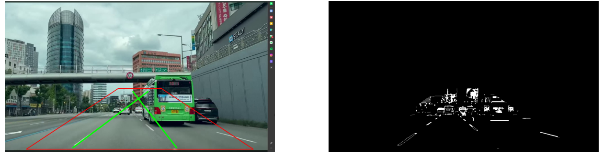
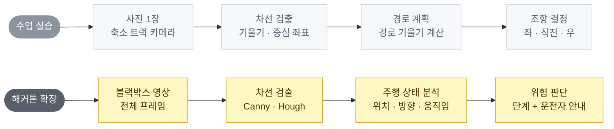
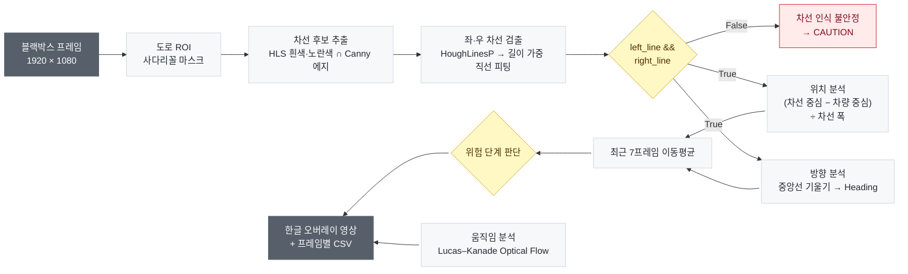
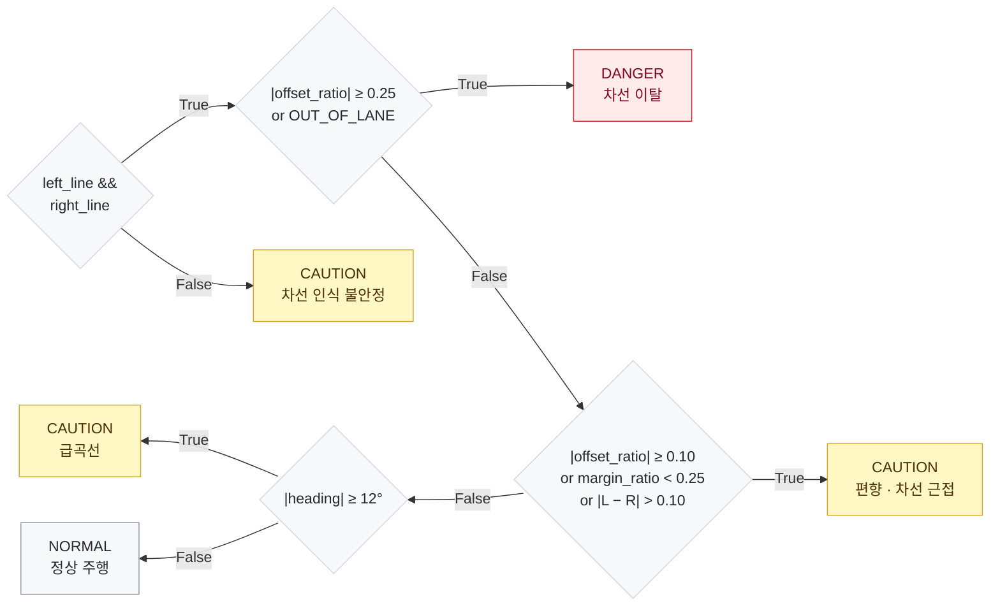
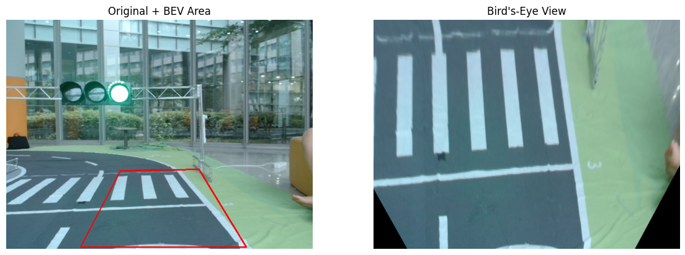
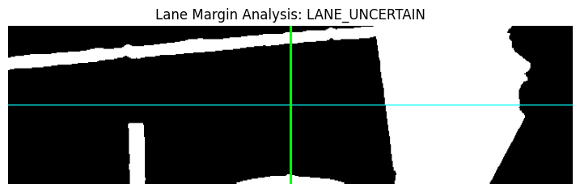

[← 프로젝트 메인](../README.md)

# ② 차량 주행 분석

**Vehicle Driving Analysis** · 블랙박스 주행상황 분석 해커톤 중 내 담당 파트

블랙박스 영상만으로 차선 내 차량 위치 · 진행 방향 · 상대 움직임을 분석하고,
위험 단계와 운전자 안내 문구를 실시간으로 표시하는 시스템

`ACE Lab 하계 코딩캠프 해커톤` · `2026.08` · `2인 팀`



<sub>왼쪽: 도로 ROI(빨강)와 검출된 좌·우 차선(초록) / 오른쪽: HLS 색상 + Canny로 만든 차선 후보 에지</sub>

---

## 개요

경북대학교 전자공학부 ACE Lab 하계 코딩캠프의 자율주행 과정 3주차 해커톤 프로젝트입니다.
주행상황 분석이라는 주제 안에서 두 파트로 나눠 진행했습니다.

- ① 전방 객체 탐지
- ② **차량 주행 분석** ← 내 담당 (설계 · 구현 · 발표)

수업 실습은 **축소 트랙 카메라 사진 한 장**에서 차선 기울기와 중심 좌표를 구하는 데까지였습니다.
이 프로젝트는 그 흐름을 **실제 블랙박스 주행 영상의 모든 프레임**에 적용하고, 결과값을 **주행 상태 판단**으로 확장했습니다.



> 새 모델을 학습하지 않았습니다. 영상 처리 기반 검출 + 규칙 기반 판단입니다.

---

## 저장소 구조

📁 <b>vehicle-driving-analysis</b> &nbsp;·&nbsp; <code>README.md</code> <code>requirements.txt</code>

<table>
<tbody>
<tr>
<td width="33%" valign="top" align="left">

📁 <a href="notebooks/"><b>notebooks</b></a><br>
<sub>최종 노트북 · 실행 결과 포함</sub>

<code>lane_state_analysis_final.ipynb</code>

</td>
<td width="33%" valign="top" align="left">

📁 <a href="src/"><b>src</b></a><br>
<sub>분석 스크립트 · 수업 제공 코드</sub>

<code>driveguard.py</code> <code>course_lib/</code>

</td>
<td width="33%" valign="top" align="left">

📁 <b>results</b><br>
<sub>결과 영상 GIF · 프레임별 CSV</sub>

<code>gif/</code> <code>csv/</code>

</td>
</tr>
</tbody>
<tbody>
<tr>
<td width="33%" valign="top" align="left">

📁 <a href="docs/"><b>docs</b></a><br>
<sub>실행 이미지 · 발표 자료 · 흐름도</sub>

<code>images/</code> <code>presentation/</code> <code>diagrams/</code>

</td>
<td width="33%" valign="top" align="left">

📁 <a href="data/"><b>data</b></a><br>
<sub>입력 블랙박스 영상 안내 (영상 미포함)</sub>

<code>README.md</code>

</td>
<td width="33%" valign="top" align="left">

📁 <a href="archive/"><b>archive</b></a><br>
<sub>v1 ~ v5 개발 노트북</sub>

<code>development_notebooks/</code>

</td>
</tr>
</tbody>
</table>

---

## 처리 흐름



- **차선 후보** — 흰색·노란색 색상 마스크와 Canny 에지가 **겹치는 부분만** 사용해 건물 · 그림자 에지 제거
- **차선 검출** — 기울기 0.35 ~ 5.0 선분만 사용, 차선 폭이 영상 폭의 18 ~ 75%를 벗어나면 오검출로 폐기
- **위치 분석** — 편향을 **차선 폭 기준 비율**로 계산해 해상도와 무관하게 판단
- **움직임 분석** — 도로 하단 특징점 이동거리의 **중앙값** 사용 (60px 이상은 이상치로 제외)

---

## 판단 규칙



- **`offset_ratio`** — (차선 중심 − 차량 중심) ÷ 차선 폭, 0이면 정중앙
- **`margin_ratio`** — 좌·우 차선까지 여유 중 작은 쪽 ÷ 차선 폭 · **`|L − R|`** — 좌우 여유 비율 차이
- **진행 방향** — Heading 3° 미만 직진 · 3 ~ 12° 좌/우 진행 · 12° 이상 급한 좌/우 방향
- **상대 움직임** — 0.7 미만 정지 · 2.0 미만 저속 · 4.5 미만 보통 · 이상 고속 (px/frame)
  - 실제 km/h가 아닌 영상 내 픽셀 이동량이며, 해상도·FPS에 따라 조정하는 실험적 기준
- 차선을 못 찾은 경우는 실제 위험이 아니라 **판단 불가**이므로 DANGER가 아닌 CAUTION으로 분류

---

## 노트북 구성

[`notebooks/lane_state_analysis_final.ipynb`](notebooks/lane_state_analysis_final.ipynb)

- **1 ~ 4절 · 환경 설정** — 프로젝트 경로, 수업 라이브러리 등록 · import
- **5 ~ 10절 · 수업 파이프라인 재현** — 샘플 이미지 → BEV → ROI → 이진 마스크 → 대표 기울기 → 차선 중심
- **11 ~ 18절 · 판단 로직 설계** — 중심 오차, 이탈 상태, 진행 방향, 좌우 여유 폭, 위험 단계, 결과 오버레이
- **19 ~ 23절 · 블랙박스 영상 분석** — 원본 시점 차선 검출, Optical Flow, 한글 오버레이, 전체 영상 처리 · CSV 저장

<p>


</p>
<sub>왼쪽: 수업 파이프라인 재현 — 축소 트랙 영상의 BEV 변환 / 오른쪽: 판단 로직 — 좌·우 차선 위치와 여유 폭 분석</sub>

---

## 결과

**test2 · 직선 위주 자동차 전용도로 (622 프레임)**
- 차선 중앙을 안정적으로 유지, Heading 약 5° → 대부분 **NORMAL**

**test4 · 급한 우측 곡선 포함 (470 프레임)**
- 곡선 구간에서 Heading 20° 이상으로 증가 → **CAUTION** 전환

**test3 · 도심 (버스 · 승용차 다수, 차선 변경)**
- 차선 폭과 중심의 변동이 커서 NORMAL ↔ CAUTION 전환이 잦음

**분석 실패 프레임** — test2 2.4% (15 / 622), test4 12.6% (59 / 470)
- 원인은 모두 같은 `UnboundLocalError: left_x` — **한쪽 차선만 검출된 프레임**에서 결과 변수가 정의되지 않는 버그 (곡선 구간에 집중)
- `src/driveguard.py`에서는 변수를 미리 초기화해 '차선 인식 불안정'으로 처리하도록 수정

---

## 개발 과정에서 해결한 문제

**① 정상 주행인데 `중심 오차 −959px`, 항상 '위험'**
- 원인: 수업용 `get_lane_center()`가 1920px 블랙박스 영상에서 차선 중심을 x≈1로 잘못 반환
- 해결: 좌·우 차선을 직접 찾아 그 중간을 차선 중심으로 사용

**② 차선이 거의 검출되지 않음**
- 원인: 축소 트랙 카메라 기준의 고정 BEV 좌표가 블랙박스 시점과 맞지 않음
- 해결: 영상 분석에서 BEV를 제외하고, 원본 시점에서 ROI + HLS + Canny + Hough로 검출

**③ 편향 기준이 해상도에 따라 흔들림**
- 원인: 중심 오차를 **영상 폭**으로 정규화
- 해결: **차선 폭**으로 정규화하고 10% / 25% 기준 적용

**④ 차선 미검출 시 실행 중단 (`TypeError`, `Mean of empty slice`)**
- 원인: `None` 값에 포맷 · `abs()` 적용, 빈 배열 평균
- 해결: 결과값 `None` 안전 처리, 프레임 단위 예외 처리로 전체 영상 처리 유지

**⑤ 상태 표시가 프레임마다 깜빡임**
- 해결: 중심 오차 · Heading · 움직임 지수 모두 7프레임 이동평균

**⑥ 영상 위 한글 깨짐**
- 원인: `cv2.putText`는 한글 미지원
- 해결: Pillow로 한글 렌더링

버전별 변경 내용은 [`archive/`](archive/README.md) 참고

---

## 한계와 확장 방향

**한계**
- 차선이 흐리거나 가려지면 검출 성능 저하 (곡선 · 도심 구간에서 한쪽 차선 누락)
- 임계값이 경험적 값이라 영상 환경에 따라 판단이 달라짐
- 실제 차속이 아닌 영상 속 상대 움직임만 분석 가능
- 블랙박스가 차량 중앙에 설치되었다고 가정

**확장 방향**
- ① 전방 객체 탐지(YOLO)와 결합해 차간 거리 · TTC를 반영한 종합 위험도 판단
- 운전 습관 분석 · 사고 예방 시스템

<details>
<summary>직접 실행해 보기</summary>

```bash
pip install -r requirements.txt

# 블랙박스 영상 분석 (course_lib 불필요)
python src/driveguard.py data/test2.mp4 --out-dir results
# → results/test2_analyzed.mp4, results/test2_frame_results.csv

# 노트북 전체 (수업 파이프라인 재현 포함, ros3_ws 경로 설정 필요)
jupyter notebook notebooks/lane_state_analysis_final.ipynb
```

한글 출력에는 맑은 고딕(Windows) 또는 나눔고딕 / Noto Sans CJK(Linux)가 필요합니다.
</details>
